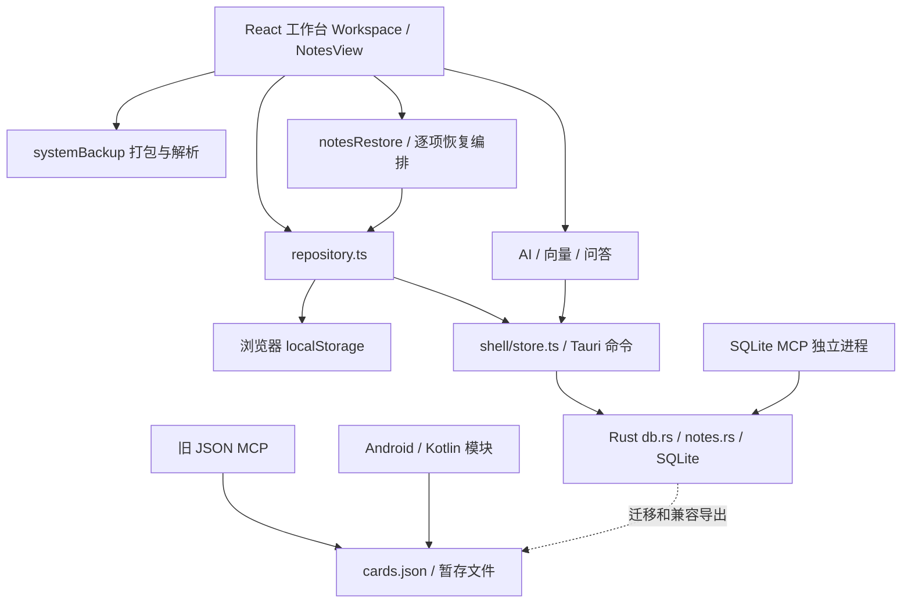

# KnowFlick 项目实际审查报告

日期：2026-10-25。审查方式：产品契约对照、代码路径检查、独立样本复现、本机验证、远端 CI 状态核对。

## 1. 判断与优先级

项目已经具备可保留的基础：React/Tauri 桌面工作台、SQLite 与全文索引、旧学习闭环、Kotlin 领域与持久化模块、跨端契约、浏览器回归和反向验证。问题集中在新增笔记与原有系统的接合处，以及“完整”“无损”“关闭生效”等陈述与实际边界不一致。

**先暂停扩大 R2–R5 的开发面，优先完成数据可靠性修复。** 这不是取消后续需求。修复后再推进“笔记进入检索与应用”的纵向链路，之后才扩展同步、画像和第三方插件。

- **P0：3 项**——已复现的关键数据可靠性问题；发布新增笔记能力前必须修复：KF-001、KF-002、KF-003。
- **P1：11 项**——当前行为缺陷、恢复风险和工程门禁缺口：KF-004～KF-013、KF-015。
- **P2：2 项**——结构治理与开发依赖维护：KF-014、KF-016。

优先级用于安排修复，不代表每项均可被远程利用，或每种条件下都会发生。尤其 KF-016 是开发工具依赖告警，不能解释为安装包已存在同等级远程漏洞。

建议顺序：笔记保存状态机 → 完整备份采集与恢复语义 → 完整性和失败报告 → 检索更新 → 模块开关与 MCP 分发 → 产品接合和平台验收。

## 2. 检查基线与边界

- 工作分支：`workbench/second-brain-validation`。
- 初始 HEAD：`65e11184bf3de86298d2df04ea164bb387dd8e4a`；检查中另一会话将原有 5 个工作区文件提交为 `9e8331c323d0695d8e96c4f50b03f0932729f86e`。后续独立浏览器回归固定在后者源码快照。
- `git fetch origin` 后，`origin/main` 为 `cd8c639`；初始 HEAD 相对它领先 **293 个提交**。初始分支差异统计为 **691 个文件、68852 行新增、41026 行删除**。这是基线管理风险，不能单凭提交数推断代码错误。
- 对应开放 [PR #95](https://github.com/bitterSmilezzz/knowflick/pull/95)。本轮只读取它作为基线和验证背景，没有修改 PR。
- 检查开始时已有未提交修改：`CHANGELOG.md`、`NotesView.tsx`、`workspace.css`、`FIRST_VERSION_ACCEPTANCE.md`、`notes_editor_smoke.mjs`。其中新增笔记本/标签界面也纳入本轮审查。KF-004 特别涉及这批功能；本轮没有改写它们。提交为 `9e8331c` 后，分支领先 main 为 294 个提交。
- 仓根没有 `.codegraph/`，按 AGENTS 约定没有创建索引，也没有使用其他项目的 CodeGraph。
- 环境：macOS、Homebrew Python 3.15、JDK 17；本轮浏览器样本使用独立的 `localhost:1435`，没有对用户真实桌面库做破坏性试验。

主要深查范围：`apps/workbench` 的笔记保存、仓储、备份恢复、检索、模块开关和 MCP；同时检查 Android 共享模块拓扑、凭据/持久化与同步边界，并执行对应验证。**这不是全仓每行代码、全部第三方包或所有平台真机的穷尽证明。** 未确认的缺口单列于第 6 节，不冒充已复现缺陷。

产品依据：[产品重规划](../../product/README.md)、[实施路线](../../product/DELIVERY_ROADMAP.md)、[笔记契约](../../NOTES_MODEL.md)、[ADR-0002](../../adr/0002-desktop-web-split-from-android.md)、[ADR-0004](../../adr/0004-notes-knowledge-applications.md)。规划不是已实现功能；旧 M1–M4 的完成标记不能替代 R0–R5 的验收。

## 3. 当前架构与问题发生的位置

这是代码路径示意，不表示 SQLite 与 JSON 已建立完整笔记同步。桌面和 Android 两套 UI 是已经接受的架构分界，不应再尝试恢复 Swift 端或把新桌面搬回 Compose。

本轮最明显的接缝：

1. **编辑器草稿、已保存 Note、全局备份快照各自更新。** 保存并发和属性变更没有同一个所有者，导致 KF-001/002/004。
2. **解析备份与恢复数据库被当成同一件事。** 测试只验证解包后的对象，实际写回仍走普通编辑接口，导致 KF-003/006/007。
3. **浏览器和桌面有不同仓储实现，但缺少同一组适配器契约测试。** 浏览器回收站通过，桌面路径仍读不出回收站。
4. **卡片、素材、新笔记尚未进入统一查询入口。** 这部分是产品阶段缺口，不能通过导航改名认定已完成。

## 4. 已确认的问题

证据级别：**R** = 使用合成样本实际复现；**C** = 当前代码路径确认，未完成该环境下的整条界面验收。每项均给出观察、根因、后果和修复方向。详细复现见 [EVIDENCE](EVIDENCE.md)。

### KF-001 · P0 · 重启后直接导出会漏掉全部新笔记 · R

**Symptom：** 浏览器库中有 1 篇笔记；刷新回默认收件箱，不打开笔记页直接导出，`notes.json` 为空，manifest 的 notes 数为 0，界面仍报告“完整备份”。

**Source：** `Workspace.tsx:137` 将 `notesState` 初始化为空，仅由 `NotesView` 的 `onStateChange` 更新；`Workspace.tsx:1388` 等导出路径直接使用这份界面缓存。顶栏和设置页各自存在导出编排。对应 *A Philosophy of Software Design* 的 Information Leakage：完整备份依赖用户是否访问过某个界面。

**Consequence：** 用户最需要依赖的迁移/恢复包缺少笔记；换机、清库后可能永久丢失内容。桌面共用同一前端状态路径，风险同样存在；本轮下载复现是在浏览器模式。

**Remedy：** 建立唯一的备份采集入口，导出时从仓储读取当前权威状态，覆盖未打开页面和回收站。先处理当前草稿的保存结果，再创建一致快照；不能只在初始化时补一次加载。

**验收：** 冷启动不打开笔记页、编辑未切页、外部更新、删除后导出、设置页导出均覆盖；恢复到新目录后逐字段核对。见 T03。

### KF-002 · P0 · 冲突提示后继续输入会覆盖外部新内容 · R

**Symptom：** 本地旧草稿与外部新内容发生修订冲突后，继续输入一个字符即可触发“保存成功”，外部新正文被旧草稿覆盖。

**Source：** `NotesView.tsx:116` 的冲突分支把 `savedRevision.current` 直接前移到对方修订号，同时清除 dirty。后续输入沿用旧正文，却使用新基线。对应 *Domain-Driven Design* 的 invariant ownership：冲突的处理绕开了修订防线。

**Consequence：** Rust/领域层的版本校验虽然正确拒绝了一次旧写，UI 下一次写却自动取得覆盖资格。用户没有选择合并或覆盖，另一窗口内容仍丢失。

**Remedy：** 冲突态保留原基线和本地草稿，暂停自动提交；提供读取远端、保留副本或明确处理冲突的动作。只有完成比较或用户明确选择后才能推进基线。

**验收：** 修订 1 草稿与修订 2 外部内容冲突后，持续输入、切页、关闭重开均不得静默覆盖修订 2；两个版本都应可找回。见 T01。

### KF-003 · P0 · 恢复笔记会重置修订、时间与删除态 · R

**Symptom：** 备份中 `currentRevision=9`、`createdAt=1000`、`isDeleted=true` 的笔记，经真实 `restoreNotesBundle → saveNote` 路径恢复到空库后，修订变为 1，时间改为恢复时刻，删除态变为 false。直接调用当前 Rust `note_upsert` 也得到同类结果。

**Source：** `notesRestore.ts:37` 使用普通编辑接口恢复。`note.ts:88` 与 `notes.rs:168` 的新建语义固定 revision=1、now、非删除。已有笔记分支也没有“按备份保留历史状态”的接口。违反 [NOTES_MODEL](../../NOTES_MODEL.md) 的恢复契约。

**Consequence：** 备份“对象解包一致”不等于新库一致；回收站内容被复活、时间线改变、版本基线丢失。

**Remedy：** 将“普通编辑”和“显式恢复”建成不同的仓储操作。空库恢复保留包内当前态与修订；合并到已有库时，明确本地修订不回退、冲突/覆盖策略和审计结果。历史明细不入包的既定范围可继续保留，不必为此扩大到完整历史同步。

**验收：** 修订 >1、已删除、收藏、置顶、归档、来源、时间戳、知识库成员和后续新修订都跨“包 → 新库 → 重启 → 再导出”核对；同时保留旧卡片评分。见 T04。

### KF-004 · P1 · 自动保存把刚编辑的笔记属性改回旧值 · R

**Symptom：** 设置笔记本“项目甲”并确认已落库，随后编辑正文，保存后 notebook 变为 null。本轮实际观察到该变化。

**Source：** `saveMeta` 更新的是 `selected`，而正文保存仍从 `noteRef.current` 展开旧对象；成功保存后也没有把这个引用同步成最新 Note。收藏存在同类路径。对应 *The Pragmatic Programmer* 的 Orthogonality：正文变化影响独立属性。

**Consequence：** 元数据表面上已保存，却在下一次正常写作中丢失。该问题涉及检查开始时的属性编辑功能；它在检查中提交为 `9e8331c`，仍需修复后才能作为 R1 收口证据。

**Remedy：** 正文和元数据由同一笔记会话串行提交；元数据采用补丁语义，或明确合并到最新保存态。保存回执必须按 noteId、提交序号和草稿版本应用，避免旧回执改变新笔记的状态。

**验收：** 属性后写正文、正文保存中改属性、快速连续输入标签/笔记本、收藏后续写、A/B 快速切换均守住。见 T01。

### KF-005 · P1 · 桌面回收站没有读取被删除笔记 · C＋原生函数 R

**Symptom：** 桌面 `readNotes` 只调用 `noteList(false, dir, 10000)`。Rust 的 false 只列正常笔记，true **只列已删除笔记**；UI 却从这一个结果里再次过滤 `isDeleted`，因此读不到回收站。

**Source：** `repository.ts:139`、`notes.rs:224`、`NotesView.tsx:65`。浏览器仓储把两种状态放在同一数组，现有浏览器回归掩盖了差异。

**Consequence：** 桌面笔记被软删后，在 UI 没有恢复入口；全量导出也可能漏掉回收站。不是数据库已经物理删除，本轮内存 SQLite 证明 deleted 分支仍有该记录。

**Remedy：** 定义清楚 `active / deleted / all` 查询语义，仓储统一返回约定的全状态或分开分页；不要把 true 简单理解成“包含全部”。

**验收：** 实际桌面命令链与浏览器适配器使用同一用例；删除、重启、回收站恢复后修订/成员不变。见 T02。

### KF-006 · P1 · 同名知识库恢复丢成员关系，仍计为成功 · R

**Symptom：** 本地 id=A、备份 id=B 的知识库名称相同。恢复跳过建 B，但成员仍按 B 加入；失败被吞掉。复现输出 `reportedCount=2`，实际 membership 为空。

**Source：** `notesRestore.ts:25–63` 按 id 或 name 判断 clash，却没有构建 id 映射，逐条 catch 也不返回失败明细。

**Consequence：** 笔记正文恢复成功，组织关系静默丢失；再次导出得到的数据已经与原包不同。

**Remedy：** 先预检并确定保留两库、合并或冲突策略；若合并，所有成员使用显式 id 映射。统计 created/updated/skipped/failed，禁止把跳过建库算作成功创建。

**验收：** 同名异 id、同 id 异名、多库成员、重复恢复、部分失败均验证实际行与回执。见 T04/T05。

### KF-007 · P1 · 恢复非事务化，失败文案却称本地未受影响 · C

**Symptom：** `restoreFromBackup` 先逐条写附件、素材、卡片和产物，再恢复笔记与设置；外层 catch 写“本地内容未受影响”。中途任一步失败时，前面成功的写入没有回滚。

**Source：** `Workspace.tsx:1251–1311`；单项仓储事务不能覆盖整份恢复。

**Consequence：** 用户看到错误后无法判断已覆盖了哪些本地内容，也可能重试产生额外变化。附件失败还会把引用改成 null 并继续报告完成。

**Remedy：** 先完整校验和预检，再暂存附件、执行有一致性边界的数据库恢复、发布结果。若产品选择部分恢复，必须明确列出已写入/失败/跳过与恢复办法，不能声称零影响。文件与 SQLite 不必假装具备一个天然事务，应明确暂存与补偿流程。

**验收：** 第 N 条写失败、磁盘满、附件缺失、设置失败、取消与重试注入；核对库和文件的最终状态。见 T05。

### KF-008 · P1 · “完整备份”静默跳过内容，并受界面查询上限限制 · C

**Symptom：** `collectBackupMedia` 对附件读取失败直接跳过；产物读取失败时用空数组导出，仍报告完整。素材加载最多 10000 条，导出产物最多 1000 条，新笔记读取也最多 10000 条且未遍历分页。

**Source：** `Workspace.tsx:1102`、`1381–1401`、设置页重复导出路径；`repository.ts:84/139`。备份采集复用了界面快照与显示查询。

**Consequence：** 缺失附件、超过上限或局部读取错误时，成功提示不能反映包内容。正文中的 `media/...` 引用也未纳入目前仅扫描素材的附件收集过程。

**Remedy：** 全量导出独立分页、收集所有受支持引用、核对应有与实得数量；失败采用阻止完整备份或明确生成“部分备份+失败清单”。保留一个可带走部分内容的出口是合理取舍，但名称和回执必须准确。

**验收：** 10001 素材、10001 笔记、1001 产物、缺失/无权读附件、重复引用、笔记正文附件；不要只把 limit 调大。见 T03。

### KF-009 · P1 · 备份校验和没有保护恢复结果 · R＋C

**Symptom：** 修改 notes.json 正文、不更新 manifest 校验和，当前解析器照常接受。代码仅对 cards.json 比较 FNV，且不匹配也只是 console.warn；其他声明校验和没有执行。没有拒绝未知未来 schemaVersion 的规则。

**Source：** `systemBackup.ts:227–291`。问题不仅是哈希算法弱，而是声明的完整性校验没有被恢复流程使用。

**Consequence：** 传输损坏、缺件或不支持的格式可能在写入前未被发现。普通校验和不提供来源认证；本报告也不把改用 SHA-256 解释为可防恶意重签名。

**Remedy：** 版本化校验格式，校验所有声明文件与媒体字节、必要文件、数量与数据形状；不支持的版本明确拒绝。旧包兼容路径单列。升级到 SHA-256 是产品规划方向，应与兼容和实际校验一起完成。

**验收：** 正文改字节、附件改字节、缺文件、重复路径、截断 ZIP、错误字段、未来版本、真正 v1 包都在落库前给出确定结果。见 T06。

### KF-010 · P1 · 浏览器笔记损坏会被当成空库，后续保存覆盖原值 · C

**Symptom：** `browserNotes()` 对 JSON 解析异常直接返回空 NotesState；部分字段类型不对也被替换为空数组。下一次 `saveNote` 基于空状态重写整个 key，没有隔离原始损坏值。

**Source：** `repository.ts:111–124`，与同文件 `browserData()` 明确报损坏的策略不一致。

**Consequence：** 用户可能误以为旧笔记没有了；一次正常新建让原始可恢复内容被覆盖。浏览器体验也存放用户数据，不能只因为是体验模式就忽略此边界。

**Remedy：** 读取失败进入可诊断的恢复状态，保留原始字节或可下载副本，阻止静默重写；完成结构验证后再允许写入。不要在错误提示中输出笔记正文。

**验收：** 非 JSON、截断 JSON、合法 JSON 错误形状、旧版字段与配额不足均不覆盖原始值；用户可显式恢复。见 T07。

### KF-011 · P1 · 内容变化后仍使用旧向量，换模型也缺身份隔离 · R＋C

**Symptom：** 原生探针创建卡片和向量，再把正文改成完全不同内容：旧 embedding 仍在，`list_unembedded_card_ids` 和同维度 stale 查询都为空。

**Source：** `db.rs:809–908` 更新卡片不使向量失效；`card_embeddings` 只有 dim、embedding、updated_at；`embeddingEngine.ts` 以维度识别空间，远端 `currentDim()` 返回 0。旧向量分支每次只处理一个 batch。

**Consequence：** 搜索可能拿旧内容或不同模型空间的向量排序，且正常后台同步不会修复同维度旧内容。模型名称改变而维度不变也无法区分。

**Remedy：** 记录空间身份与内容指纹/修订，按内容变更标脏；查询向量与索引空间一致。模型切换、失败回退和重算应受单个可取消任务管理，并循环处理完整 stale 集。

**验收：** 改正文后旧向量失效、同维度换模型不混用、超过 batch 的脏数据全部重算、远端失败回退与删除并发均覆盖。见 T08。

### KF-012 · P1 · 多个模块开关只改配置，没有改变功能执行 · C

**Symptom：** `official-inbox-sniff`、`official-doc-extractor`、`official-cognitive-brief`、`official-mcp-server` 的生产源码引用仅在注册表，相关执行路径没有读取这些 id 的启用状态。ASR/复习有单独接线，不能据此推断其他开关也已生效。

**Source：** `pluginRegistry.ts`、`WorkspaceSettings.tsx` 与 `Workspace.tsx`。持久化了 enabled 不等于实现了生命周期。

**Consequence：** 用户关闭模块后，抓取/解析/简报/外部独立服务的真实边界与设置不符。“关闭停任务、保留内容”的 R1 目标尚未完成。

**Remedy：** 先完成官方模块的最小生命周期和能力检查，覆盖入口与执行层；任务取消、已有内容读取和独立 MCP 进程的吊销语义分别定义。不能只隐藏按钮，也不应为此立刻建设通用插件市场或沙箱。

**验收：** 每个开关 ON/OFF 的行为矩阵；关闭前正在运行任务、重启后状态、旧数据仍可阅读与导出；独立 MCP 进程也必须验证策略。见 T09。

### KF-013 · P1 · 安装用户复制的 MCP 配置指向源码相对路径 · C

**Symptom：** 设置页用 `generateMcpConfigSnippet("tools/mcp-server.mjs")` 生成配置；外部客户端的工作目录不保证是仓库，安装用户通常也没有该脚本。Tauri bundle 未列出这个脚本或相应 sidecar。

**Source：** `WorkspaceSettings.tsx:61`、`mcpServer.ts:520`、`tauri.conf.json`。仓内运行 MCP 冒烟不能验证安装用户接入。

**Consequence：** 用户按界面操作复制配置后可能直接遇到 module not found；设置页“可接入”承诺缺少分发链路。旧 JSON MCP 与新 SQLite MCP 还具有不同数据和写授权语义，不能任选一个配置替代。

**Remedy：** 决定并实现一个安装后可用的正式入口：随包安装或明确安装独立工具。配置使用实际可执行入口和明确的库目录；校验运行时版本。旧 JSON MCP 保留兼容说明，不能静默切错知识源。

**验收：** 在无源码仓库、工作目录任意的干净环境，复制配置完成 initialize/list/search/read；另测默认只读与显式写授权目标。见 T10。

### KF-014 · P2 · 保存、备份和副作用由多处编排，修改相互牵连 · C

**Symptom：** `Workspace.tsx` 2431 行承担加载、导入、AI、邮箱、订阅、附件、备份、恢复、导航和选择；导出代码在顶栏/设置页重复。部分 domain 模块直接依赖 shell 的执行能力和类型。行数只是定位线索，实际问题由本报告的漏快照和恢复重复路径证明。

**Source：** `Workspace.tsx`、`repository.ts`、`embeddingEngine.ts`、`mcpServer.ts`。对应 *Refactoring* 的 Divergent Change 与 *Clean Architecture* 的 policy/detail 边界。

**Consequence：** 增加一个数据实体要记得修改多个采集入口；后续 agent 容易局部修好但留下另一条路径。直接大拆文件也可能掩盖现有回归。

**Remedy：** 在行为修复并有特征测试后，逐步抽出 NoteSession、BackupService、RestoreService、IndexJob 等有明确职责的模块；领域协议与宿主实现分开。先消除重复业务决定，不按行数机械拆分，也不要重写平台技术栈。

**验收：** 两处导出共用一条业务路径；恢复 UI 不再逐行制定数据库策略；纯领域规则可在无 Tauri 环境测试，桌面适配器另有契约测试。见 T11。

### KF-015 · P1 · 现有“已验”证据没有覆盖关键状态转换 · R＋C

**Symptom：** 全部 447 项前端测试通过、Rust 111 passed/3 ignored，但 KF-001/002/003/004 仍可复现。`systemBackup.test.ts` 的“无损往返”主要验证打包/解包；所谓旧 v1 用例实际仍用 v2 打包器，没有真正删除 notes.json 或构造 v1 包。笔记浏览器回归不会走桌面 `readNotes`。

**Source：** `systemBackup.test.ts`、`note.test.ts`、`notes_editor_smoke.mjs`、[验收清单](../../FIRST_VERSION_ACCEPTANCE.md)。对应 *How Google Tests Software* 的 change/risk coverage，以及 *xUnit Test Patterns* 的误导性测试意图。

**Consequence：** 文档、字符串守卫和正常路径测试叠加后容易产生过度信心；“证据标识还在”不能证明危险链路正在被验证。本轮首轮门禁出现浏览器输入超时与服务退出；固定快照独立重跑后 14 套通过。前后记录及真机 SKIP 均见 EVIDENCE，不应混写为全平台已验收。

**Remedy：** 为本轮缺陷建立能先在旧实现失败的回归；分别验证包格式、仓储落库、UI 工作流与真实安装。报告 PASS/FAIL/SKIP/缓存状态，保留单套失败现场。已有反向验证值得保留和扩大到关键数据路径。

**验收：** 见 T01–T08 的具体反例与 T12 的证据收口；不要用新增用例数量或静态声明数代替结果。

### KF-016 · P2 · 开发依赖存在已公布告警，需要独立升级验证 · R（依赖扫描）

**Symptom：** `npm audit` 完整依赖树报告 3 个受影响包：`vitest`、`tinypool`、`@vitest/mocker`。这是包节点数量，不能相加当成 3 个独立漏洞。本轮安装版本与生产依赖扫描见 EVIDENCE。

**Source：** `package-lock.json`，以及维护者公告：[Tinypool worker options](https://github.com/tinylibs/tinypool/security/advisories/GHSA-5gmw-xhrv-c9v3)、[Tinypool run options](https://github.com/tinylibs/tinypool/security/advisories/GHSA-85c8-ppgw-ccpr)、[Mock redirect 路径](https://github.com/vitest-dev/vitest/security/advisories/GHSA-82fw-gwwq-j7x9)、[Mock registration](https://github.com/vitest-dev/vitest/security/advisories/GHSA-qxg6-89mg-rqv8)。npm 将部分包标为 critical，但维护者 Tinypool 公告标为 High；严重度来自不同口径。

**Consequence：** 测试工具链落后于维护者修复。Tinypool 利用还需要原型污染等前提，Mocker 公告对公开插件/服务可达性有具体条件；本轮没有证明本项目运行方式可被利用，也没有证明桌面生产包受影响。

**Remedy：** 单独选择兼容的修复版本、更新锁文件并验证 Node 22 CI 和本机；不要执行不加分析的 `audit fix --force`。先确认实际调用与暴露面，按公告修复已解析依赖。不要顺带把 React/Tauri/Android 全部升级。

**验收：** 完整树和 `--omit=dev` 分别留档；原告警消除或每条有可核验的范围说明，447 项基线用例及全门禁通过。见 T14。

## 5. 架构健康抽样（Health Dashboard）

**Mode：Health Dashboard。Scope：当前仓库与工作区，新增笔记/备份/MCP 深查；不是全仓覆盖率。**

这是 Brooks 健康技能的有限发现集评分：每维最多 3 项、balanced 每个 Critical -15 / Warning -5 / Suggestion -1。P0/P1 是产品修复优先级，与这里的风险等级不是同一个刻度。为避免把“没查到”当成健康，发布判断以前面的实际问题和后面的退出门槛为准。

- 代码变更维度 **85**：KF-004 的属性与正文互相影响，Critical/R2。
- 架构维度 **85**：KF-014 的多职责编排、KF-012 的开关策略断裂、KF-013 的分发边界，各 Warning。
- 债务维度 **65**：KF-001 的完整备份语义失真、KF-003 的恢复语义失真，各 Critical/R6；KF-011 的失效规则缺失，Warning。
- 测试维度 **95**：KF-015 的测试名与所验证链路不一致，Warning/T1。超时归因尚未确认，不额外按产品缺陷扣分。

综合：`85×0.25 + 85×0.30 + 65×0.25 + 95×0.20 = 82/100`。这只对应上述 8 个抽样观察，不是“82% 的功能可用”。历史评分针对更早 Swift/JSON 阶段或不同范围，**不可据此比较项目在变好或变坏**。

Top Findings 按第 4 节的 Symptom → Source → Consequence → Remedy 执行：KF-001、KF-002、KF-003、KF-005、KF-011。最值得深入的是恢复边界和适配器契约；应在修复时补充针对性设计审查，不建议先做全仓风格整改。

## 6. 产品与平台缺口：单列，不算当前已复现 bug

### G01 · R1 切片存在，完整 R1 与 R2 尚未交付

新 Note 模型、修订表、笔记搜索和成员关系已存在；旧材料没有自动变成 Note。`model.ts` 的旧内容仍是 material/card；“全部知识”、现有问答与 MCP 主要检索旧内容。`note_search` 的库内过滤 API 存在，NotesView 当前搜索没有选择知识库范围的界面。

应先完成稳定的笔记写作/恢复，再交付“选定知识库 → 搜原文 → 打开笔记 → 应用引用”的一个完整增量。素材统一、切片和应用检索属于 R2，不能因为它们未完成就认定 R1 首个切片实现失职；同样不能把三组导航视作 R2 完成。见 T13。

### G02 · 外部依赖的真实质量证据仍缺

现有记录列明：真实模型生成与引用质量、真实 IMAP、物理麦克风和桌面录音保存仍有验收缺口。本轮没有使用用户账号或密钥调用外部模型/邮箱，没有替用户新增费用，也没有录制私人音频。需要按提供商和设备分别建样本记录；不能用假服务的链路通过替代质量结论。

### G03 · 安装包构建不等于安装、首启和升级验收

本轮核对的初始 `65e1118` 上，远端 Android 与桌面三平台相关构建检查成功；但这不验证 Windows/Linux 安装后的导入、复习、测验、恢复，也不验证 macOS 系统权限与真实设备。该 SHA 的 CI 结果不覆盖之后提交的 `9e8331c` 属性编辑。见 T12。

### G04 · 规模与后台任务缺少新笔记基准

现有 4000 条 UI 与 1 万卡搜索基准不能直接外推到产品规划的 1 万笔记/10 万切片。界面全量加载、10k/1k 查询上限、每两秒整库指纹、向量任务无统一并发/取消，在数据增长后需要测量。整库指纹有防漏变更的历史理由，不能为了优化擅自改回 mtime。

T11/T13 完成后建立参考设备与固定数据集，分别测冷启、键入、全文搜索、备份峰值内存和后台模型工作时交互。规划中的 p95 目标是待校准目标，不是当前成绩。

### G05 · 凭据保护仍有明确技术债

桌面 API key 是单独 0600 文件，设置页已披露降级；它不等于系统钥匙串。Android 的 `SystemCredentialStore` 已记录弃用依赖与加密失败回退，且有降级提示。这里没有新复现的密钥泄露，不应以“发现明文”重写已经说明的边界。

后续单独安排宿主凭据迁移和恢复策略，覆盖旧密钥迁移、加密失败、保存失败与删除；不要夹带进笔记数据修复。外部 MCP 的项目授权/默认只读是 R4 目标；已存写工具与旧只读暂存工具需要明确迁移，不可称现已实现项目隔离。

### G06 · Android 不能被当作新笔记同步的既有实现

Android 仍是 Kotlin 领域/持久化/Compose UI，旧 cards/settings 契约继续有效；新笔记、修订、知识库成员和 .kfbackup v2 不是它已经支持的交换协议。R3 应先做未知块无损保留/只读，再开放双端编辑和冲突合并。现有局域网卡片同步不能作为新笔记同步证据。

冻结的 JVM desktop 不加功能、不立即删除；其维护成本可在第一套学习闭环有真实验收后，按 ADR 单独决定。当前不批准 iOS/iPadOS，也不恢复 `apps/mac`。

## 7. 执行与发布门槛

具体工作包见 [TASKS](TASKS.md)。不要派一个“把所有问题修好”的任务同时改整个工作区。

**新增笔记能力退出门槛：**

1. KF-001/002/003 的回归在旧实现必失败、修复后通过。
2. KF-004/005/006/007/008/009/010 全部有仓储与用户路径证据；有意保留的受限行为在界面和文档如实显示。
3. 从真实旧数据副本完成升级；从完整备份恢复到新目录，重启后正文、引用、成员、附件字节、旧卡 id 与学习进度一致。
4. 全门禁的 FAIL 清零；SKIP 和缓存不计新通过；浏览器冒烟、原生 IPC、真实安装分开报告。
5. Android 与既有九项学习闭环按修改范围回归；共享协议变更须两端 CI 通过。
6. 对外功能陈述只覆盖本次真正验收的平台与依赖；未具备账号/设备的任务保持“待真实验收”。

**协作基线：** 先确定一个带当前工作成果的集成提交，再分派工作。新 agent 不能从当前旧 `origin/main` 开始实现这些修复；也不能擅自把 293 个提交 rebase/合并/删除。按 MULTI_PLATFORM 的短分支与 GitHub 中枢规则安排集成，禁止跨机复制工作目录。若在同一个 checkout 工作，保存状态机与恢复链路每次只允许一个写入者。

本报告只提出执行契约；具体修复完成时间、平台验收结果与是否发布，都必须由后续交付证据更新。
