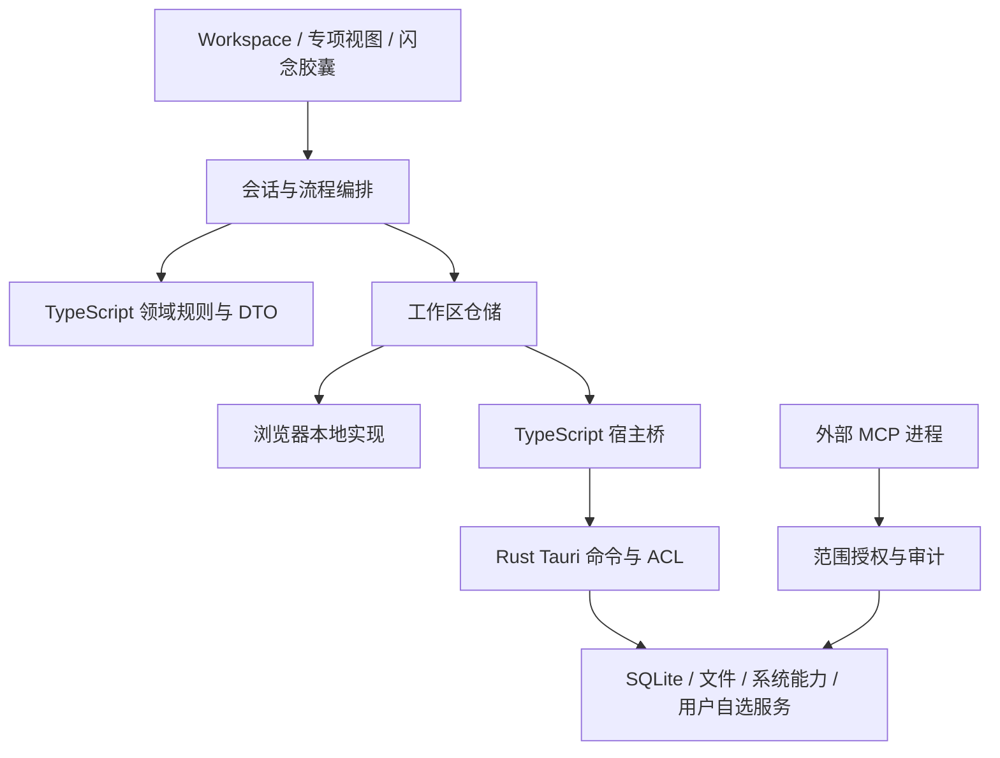

# 工程架构与编码设计

基线：2026-11-12 仓库工作树，分支 `workbench/second-brain-validation`，HEAD `ca0858d`。本文区分现有边界和后续设计。已有实现以源码为准，新增产品范围以 [ADR-0004](../../adr/0004-notes-knowledge-applications.md) 为准。本页的拆分建议不是重写计划，也不另立一套协议。

## 一套界面，多处发布

| 工程边界 | 当前职责 | 新功能落点 |
| --- | --- | --- |
| `apps/workbench` | Vite、React、TypeScript；桌面和浏览器共用界面。入口 `src/main.tsx` 在主工作台和闪念胶囊间选路，最外层有错误边界 | 功能先写在一套界面；平台差异通过仓储和宿主能力暴露，桌面与浏览器不复制页面业务 |
| `apps/workbench-go` | Go 1.27、Wails v3、纯 Go SQLite（modernc.org/sqlite）；系统窗口、托盘、快捷键、通知、网络请求、原子文件读写与 ASR 外部进程 | Windows/macOS/Linux 共用服务与存储语义；与平台绑定的窗口、菜单、安装与系统交互留在这里（Rust 壳已随 ADR-0042 删除） |
| `apps/android` | 独立 Kotlin/Compose，保留学习、剪藏、朗读、磨耳朵、学习地图、微件等已有场景；`:domain`、`:shared-data`、`:shared-ui` 与 `:app` 各有职责 | 新笔记协议采用先只读保留、再可编辑、再离线队列的顺序；Android 手机上的分享、拍照、录音、系统返回和通知由宿主接入。Android 平板沿用同套代码做布局与输入适配 |
| `apps/android/desktop` | 冻结的 JVM/Skiko 宿主，保留兼容和既有发布链路 | 不承担新桌面功能；不恢复已删除的 `apps/mac`。iOS/iPadOS 需要独立平台决策 |
| `shared/assets`、`tools` | 唯一学科映射和卡片底图；跨端校验、验证、产物组装 | 先写跨端数据契约和对照样本，两端各自实现。`cards.json`/`settings.json` 是学习交换基础，不能据此声明 Android 可读桌面 SQLite 或 `.kfbackup` 新数据 |

## 代码地图与依赖方向

| 层 | 当前源码入口 | 编码约定 |
| --- | --- | --- |
| 页面与共享组件 | `src/ui/workspace/Workspace.tsx`、`NotesView.tsx`、`WorkspaceSettings.tsx`、`src/ui/BrainViews.tsx`、`StudyViews.tsx` | 页面呈现加载、空、成功、部分失败、权限拒绝和冲突等状态；展示事实及可恢复动作。业务规则复用一处，避免各视图自行解读范围或拼装写库请求 |
| 流程和会话 | `ui/workspace/noteSession.ts`、`backupCollect.ts`、`backupRestore.ts`、`notesRestore.ts`、`externalRefresh.ts` | 编排防抖、取消、重试、批次依赖、回执与刷新。交互缓存不是真相源；导出不依赖用户先访问过某个页面。可独立验证的规则优先抽成无 I/O 函数 |
| 领域与边界类型 | `src/domain/note.ts`、`dto.ts`、`reviewFacts.ts`、`restoreRules.ts`、`profileLearning.ts`、`systemBackup.ts`、`aiChat.ts` | 用判别联合描述结果（例如冲突、已保存、拒绝），在数据进入处校验后再转内部类型。领域规则不依赖 React、浏览器存储或 Tauri；跨层不以宽泛断言替代校验 |
| 仓储与宿主桥 | `ui/workspace/repository.ts`、`src/shell/store.ts`、`src/shell/mail.ts` | 仓储决定桌面/浏览器路径；宿主桥封装请求、DTO 映射和凭据处理。浏览器以 `localStorage` 等宿主能力提供有限体验，配额或损坏时保留原数据并提示。专属能力缺失时明确降级，不把模拟回执当真机成功 |
| Go 宿主与存储 | `main.go` 装配服务；`internal/library`（建库与迁移）、`internal/mail*`、`internal/httpx`、`internal/mcpgrants`、`internal/media`、`internal/creds` 等 | `main.go` 装配服务，方法校验输入、路由到实际职责模块；事务、约束、范围校验、文件路径边界由实际写入层强制。新增方法要同时维护 Go 服务、bindings 生成与 TS 适配（不再有 `build.rs` / capability 三处对齐） |
| 外部读写 | `tools/mcp-server.mjs`、`tools/mcp-access.mjs`、`tools/knowflick-mcp/` | 两条入口分别维护兼容，但同样验证令牌、模块、范围和操作权限。前端隐藏按钮不能替代外部进程的授权。保留旧卡片暂存流程与人工确认边界 |

新页面可从 `Workspace.tsx` 装配；当同一个业务规则被两个页面或宿主共享时，再从入口提取纯规则和宿主适配，避免把整个 `Workspace` 或 `lib.rs` 重写作为交付前置。文件、命令、数据字段和版本矩阵详见 [接口与数据](03-INTERFACES-AND-DATA.md)。

## 关键工作流的实现方式

| 流程 | 编码设计与不变量 |
| --- | --- |
| 捕捉与导入 | 来源解析、稳定身份、转换结果、预览与入库分开。统一接入收件箱和笔记模型，保留来源身份和原件；报告成功、重复、跳过、失败与重试入口。网页、邮件、录音和本地文件使用独立适配器；每个适配器不另写一套笔记编辑或搜索 |
| 笔记保存与版本 | 普通编辑携带 `baseRevision`；一次 SQLite 事务写当前态、正文修订与全文索引。来源和附件链接不可因为临时读取失败被悄悄清空。标题或正文追加修订，元数据更新保留修订语义；同时编辑发生冲突时保留本地草稿和实际最新状态。恢复专用入口保留包内身份、时间、删除态和实际历史 |
| 全文、语义与引用 | 按库/项目和权限先过滤，再排名、融合和截断。无模型可查原文；词面哈希不是语义模型。变更或删除原文使对应索引失效；检查原件、段落、修订和访问范围后再给模型与用户。后续扩充模型身份和切片版本时，先做旧索引迁移、可重建、状态反馈和切换测试 |
| 问答、复盘与画像 | `reviewFacts` 只产有时间和出处的事实，建议层独立接模型。发送前把范围、原件版本、逐次同意和证据白名单变成请求快照；切换范围或撤销后，后续请求不带旧范围历史。模型输出先校验再显示，保存或确认另走显式动作；不把缺记录判成失败 |
| 学习与历史 | SM-2/FSRS 的评分、间隔和统计语义遵守跨端样本。桌面逐次事件与评分写入同一事务；重试使用稳定事件身份，保证重复请求不重复计数。覆盖起点前的累计数据照常显示为累计，不补造逐次历史，也不从全库推算项目数据 |
| 导出、恢复与删除 | 将包格式、采集、恢复预检、执行和报告分层。数据库快照应来自一致读；附件、设置等跨存储边界需明确一致性限制。校验先于写入，恢复报告区分跳过、失败、取消和已完成部分；同 ID 分歧不静默覆盖。回收站状态、索引可见性和未来跨端墓碑要联动 |
| 模块与后台任务 | 开关需进入执行层：禁止新任务，暂停或取消相应在途任务，内容保持可读。重任务串行起步，按任务记录来源、目标版本和可取消状态；恢复或切换库后核对任务归属。运行时、更新、崩溃隔离与第三方权限是 R5 后续能力 |
| 外部输出 | 导出与 MCP 仅使用当前授权的数据；无法确定范围时拒绝。第三方已经接收的静态文件不能靠撤销自动召回，导出应写生成时间、范围与来源。单向复制、加密快照与实时同步分开设计、分开命名、分开验收 |

## 按小批次推进的数据与架构工作

1. **守住已有路径。** 保持 `knowflick.db` 的向前增量迁移。新表或字段先定义空库与旧库默认值、边界类型、回滚/故障测试。同步更新备份字段、统计和兼容规则；恢复旧包时显式说明没携带的内容。新增可选功能不要求所有用户迁库到新服务。
2. **稳定出处和原件。** 当前笔记正文是可往返的 Markdown，附件从 `media/` 引用；版本化块 ID、原件内容寻址、修订旁车和更细引用粒度属于后续。先约定未知块无损保留与通用导出，再做编辑器、移动读取及生命周期。用户修订过的 OCR/ASR 内容是权威内容，清缓存不得删除。
3. **量化检索与任务。** 沿用 SQLite 全文与现有向量路径；真实查询集和重建耗时能说明瓶颈时，再确定是否拆独立索引库或替换算法。向量维度相同不等于空间相同，任何提供商/模型/切片变更都需定义重建和降级行为。AI 工作与界面响应预算分开量。
4. **独立实现同步协议。** 备份文件复制先保持可恢复和可验证；等事件标识、墓碑、引用、写入排序、附件校验和密钥恢复经过验证，再启动双向变更协议。先用隔离数据和两台设备测网络重试/重复投递/旧客户端；保留冲突双方供用户处理。S3、更多 OAuth 连接器和浏览器后台均有独立接入与退场方案。
5. **先磨合官方接缝，再开放运行时。** 官方模块先统一启停、能力探测、失败回执和数据归属。第三方生态要另定进程隔离、权限声明、版本契约、可卸载性和升级策略；保留 MIT 项目许可，逐项核对代码、模型、字体与服务许可。

这些增量的设计来源是 [本地数据与 AI](../LOCAL_DATA_AND_AI.md)、[笔记实施契约](../../NOTES_MODEL.md)、[备份范围缺口](../BACKUP_COMPLETENESS_PLAN.md) 和 [模块规范](../../PLUGIN_SPECIFICATION.md)。遇到历史方案与现行契约不一致，先核对源代码与最新证据，再修改对应规范或补 ADR。

## 写一项功能时需要交付的内容

- **行为**：列能力编号、触发入口、作用对象、权限和不同宿主的降级。固定一条主链、一条失败恢复链和受影响的旧用户路径。
- **契约**：说明字段单位和来源、版本、可空性、分页、重试、冲突、删除态、错误与结果类型；给至少一条前后对照。敏感数据预览及授权在发出网络请求前，凭据不进入内容包、日志和测试夹具。
- **实现**：先写最小纵向链，纯规则归领域层，I/O 归仓储与宿主；使用 TypeScript 严格检查和 Rust 事务约束。界面文案用中文并给可行下一步；不可撤销操作使用既有确认机制。Kotlin 公共源码避免平台专用 API，平台差异沿已有接缝注入。
- **验证**：单测钉失败和兼容语义，集成测试跨层，浏览器断言交互，安装态验证系统功能，外部服务单独留真实证据。详细矩阵见 [实施与验收](05-DELIVERY-AND-VALIDATION.md)。
